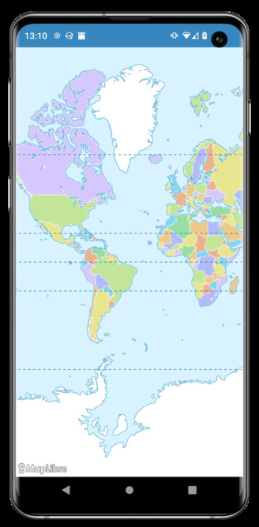
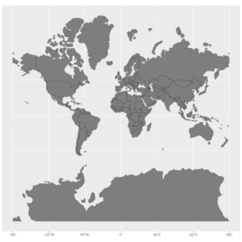
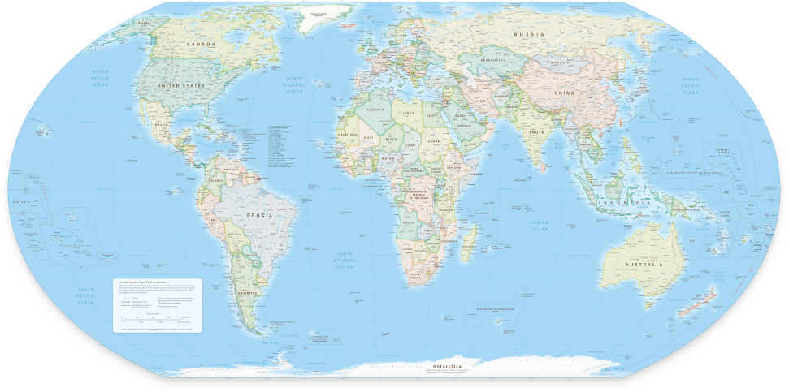
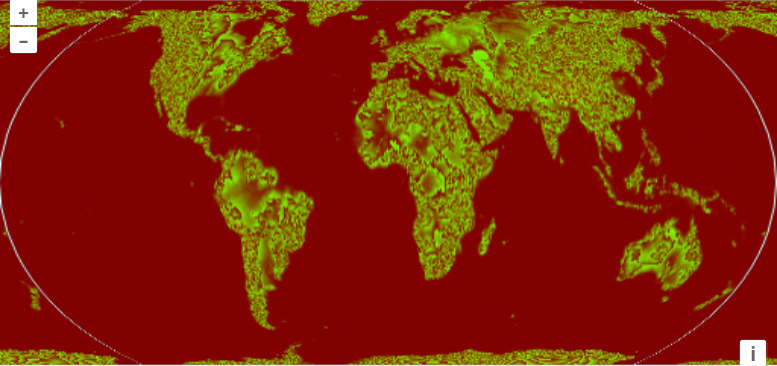
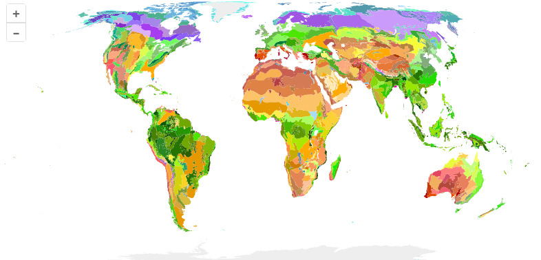
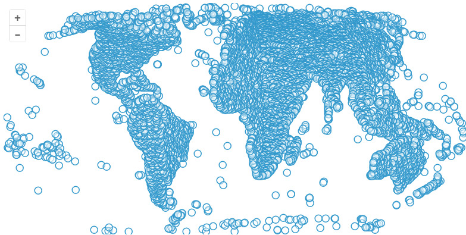
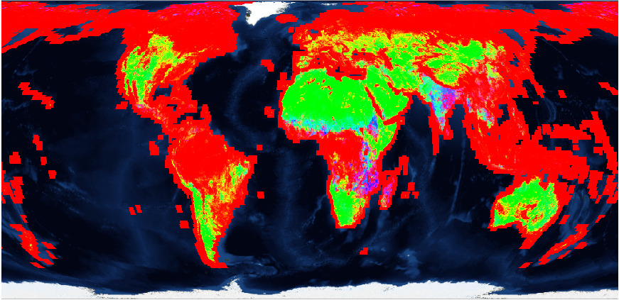
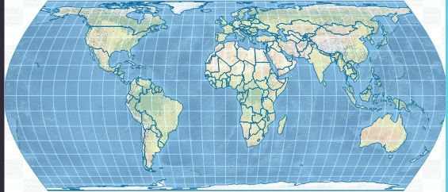

% Equal Earth Maps Using Cloud-Optimized Formats
% Pirmin Kalberer  <pka@sourcepole.ch>
% CNG Zürich 2026
---
width: 1600
height: 900
---

# The current state of Web Mapping

* Web Mercator projection
* Sometimes a globe

# Web Mercator - the bad parts

Africa actually has 14 times as much area as Greenland

::: notes
* Gerardus Mercator, 1569
* Conformal cylindrical map projection
* Good for navigation
* north everywhere "up" and south "down", while preserving local directions and shapes
:::

# Equal Earth map projection

Bojan Šavrič, Tom Patterson, Bernhard Jenny, 2018

<https://www.equal-earth.com/>

::: notes
Inspired by the Robinson projection, retains the relative size of areas.
:::

# Cloud-optimized formats

* Raster
  * Cloud Optimized GeoTIFF
  * GeoZarr
* Vector
  * GeoParquet
  * FlatGeobuf
* Containers
  * PMTiles
  * SOZip
* Point clouds
  * COPC

## PMTiles (Raster)

<https://equal.bbox.earth/pmtiles/>

## FlatGeobuf

<https://equal.bbox.earth/fgb/>

Dynamic center meridian:

<https://openlayers.org/en/latest/examples/equal-earth-geojson.html>

## GeoParquet

<https://equal.bbox.earth/geoparquet/>

::: notes
- OvertureMaps POIs
- Cloud Optimized GeoParquet (COGP)
- https://github.com/Kanahiro/cloud-optimized-geoparquet
:::

## GeoZarr

[Demo](http://localhost:5173/geozarr)

# Behaviour for interactive maps

Proposals:

* Dynamic center meridian
* Transition to Mercator for higher zoom levels

## A New Interactive Equal-Area Map

Equal-area projection with transition to Mercator

<https://www.benjoffe.com/map>

# Takeaways

* Equal Earth is here - use it!
* Basic support for cloud-native formats 
* Web mapping libraries need support for antimeridians != 180°

# Thank you

Pirmin Kalberer

<pka@sourcepole.ch>

[mapstodon.space/@implgeo](https://mapstodon.space/@implgeo)

